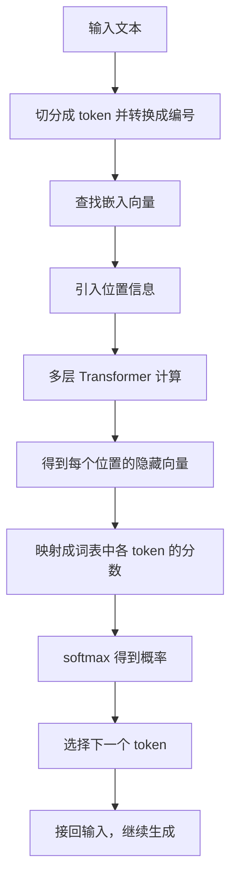
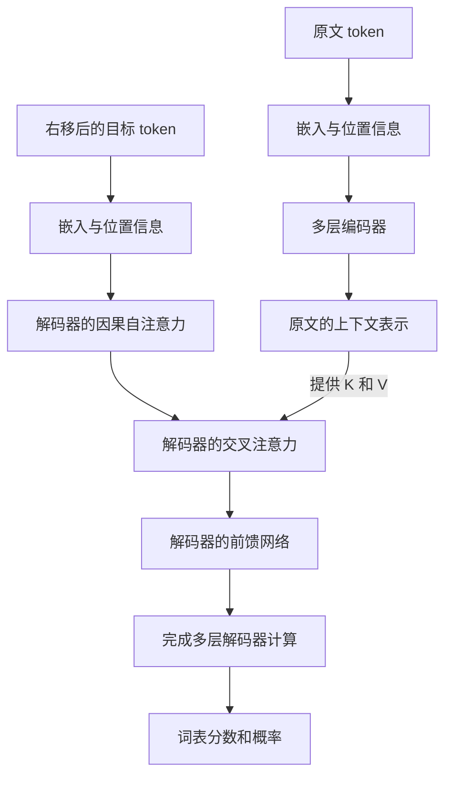

# Transformer 从零理解：背景知识、架构与训练逻辑

> 本文经 AI 辅助核对原始论文、公式与教学代码，补充了训练目标和因果注意力成本的条件；尚未经人工专家审定。

> 阅读目标：从“模型为什么要把文字变成向量”开始，理解 Q/K/V、注意力、完整网络、训练目标和文本生成之间的联系。
>
> 适用范围：以标准文本 Transformer 为主。先讲通用计算，再区分 2017 年的原始编码器—解码器结构和现代语言模型的常见结构。数值例子由本文手动设定，用于解释计算，不代表真实模型的参数或词义。
>
> 数学要求：会做加减乘除即可开始。向量、矩阵、概率、梯度等知识会在使用前解释。带“进一步理解”的内容可以第二遍再读。

## 阅读路线

建议第一次按顺序读到第 17 节。第 18—21 节用于理解效率、常见变体和纠正常见误解。最后用代码和自测题检查理解。

1. [先看整体：Transformer 在做什么](#s01)
2. [数学准备：向量、矩阵和加权求和](#s02)
3. [神经网络准备：参数、损失和训练](#s03)
4. [从文本到向量：token、词表和嵌入](#s04)
5. [为什么需要注意力](#s05)
6. [顺序信息：位置编码](#s06)
7. [Q、K、V：同一份信息的三种表示](#s07)
8. [逐步拆解注意力公式](#s08)
9. [完整数值例子：从 X 算到 Z](#s09)
10. [遮罩、自注意力和交叉注意力](#s10)
11. [多头注意力：多个信息处理通道](#s11)
12. [前馈网络：对每个位置做非线性处理](#s12)
13. [残差连接、归一化和 Dropout](#s13)
14. [把零件组装成 Transformer](#s14)
15. [从隐藏向量到下一个 token 的概率](#s15)
16. [训练到底如何进行](#s16)
17. [推理与生成：为什么通常逐个 token 产生](#s17)
18. [KV cache 和计算成本](#s18)
19. [现代常见变体](#s19)
20. [参数、输入和中间结果的完整区分](#s20)
21. [常见误解与回答](#s21)
22. [可运行的最小注意力代码](#s22)
23. [自测题与参考答案](#s23)
24. [符号表与术语表](#s24)
25. [参考资料与核实范围](#s25)

<a id="s01"></a>
## 1. 先看整体：Transformer 在做什么

### 1.1 先区分三个层次

理解 Transformer，首先需要区分：

| 层次 | 回答的问题 | 例子 |
|---|---|---|
| 架构 | 信息在模型内部如何流动？ | 注意力、前馈网络、残差连接怎样组合 |
| 训练目标 | 用什么标准判断模型做得好不好？ | 提高真实下一个 token 的预测概率 |
| 使用方式 | 训练完成后怎样得到结果？ | 输入提示，逐步生成回答 |

**Transformer 是一种神经网络架构。同一种架构可以配合不同训练目标，用于不同任务。**

例如，可以根据一句话预测它的情感类别，也可以把一种语言翻译成另一种语言，还可以根据前文生成后文。

### 1.2 一条完整的数据路径

以生成文本的语言模型为例：



如果阅读器不能显示 Mermaid 图，可以按以下文字理解：

> 文字 → 编号 → 向量 → 多层信息处理 → 词表分数 → 概率 → 下一个文本片段。

这里的“隐藏向量”是模型内部的一组数。它承载当前计算得到的信息，通常不能直接读成一句人类语言。

### 1.3 一层 Transformer 主要完成两类处理

- **注意力：**让一个位置从允许访问的位置收集信息。
- **前馈网络：**对收集后的表示做进一步的非线性变换。

残差连接和归一化帮助这些处理在多层网络中稳定进行。位置机制提供顺序线索。后面的章节将逐项说明。

<a id="s02"></a>
## 2. 数学准备：向量、矩阵和加权求和

### 2.1 标量、向量、矩阵和张量

**标量**是一个数，例如 $0.7$。

**向量**是一组按顺序排列的数，例如：

```math
x=[0.2,\;-0.5,\;1.1]
```

这个向量有 3 个分量，也可以说它是 3 维向量。“维度”在这里表示有多少个数。

**矩阵**是一张数表。例如：

```math
X=\begin{bmatrix}
1&0\\
0&1\\
1&1
\end{bmatrix}
```

它有 3 行、2 列，形状记作 $3\times2$。本文约定：**每一行对应一个文本位置，每一列对应一个特征分量。**

**张量**是更一般的多维数表。一个批次中有 $B$ 段文本，每段有 $n$ 个位置，每个位置用 $d$ 个数表示，就可以组织成形状为 $B\times n\times d$ 的张量。

为减少符号，前半部分公式先省略批次这一维。

### 2.2 形状为什么重要

如果 $X$ 的形状是 $n\times d$，权重矩阵 $W$ 的形状是 $d\times r$，那么：

```math
Y=XW\in\mathbb{R}^{n\times r}
```

符号 $\mathbb{R}^{n\times r}$ 表示“由实数组成、形状为 $n\times r$ 的矩阵”。

这里的矩阵乘法对每一行应用同一套变换规则。位置数仍然是 $n$，每个位置的特征数从 $d$ 变成了 $r$。

例如：

```math
[1,2]
\begin{bmatrix}
1&3\\
2&4
\end{bmatrix}
=[1\times1+2\times2,\;1\times3+2\times4]=[5,11]
```

矩阵乘法不是把对应位置的数直接相乘。

### 2.3 点积：把两个向量变成一个匹配分数

两个长度相同的向量可以计算**点积**：对应分量相乘，再求和。

```math
q\cdot k=\sum_{r=1}^{d_k}q_rk_r
```

例如：

```math
[1,2]\cdot[3,4]=1\times3+2\times4=11
```

在注意力中，模型学习如何构造 $q$ 和 $k$，让这个分数有助于完成任务。

点积会同时受到向量方向和长度影响。因此，它不能直接等同于“语义相似度”，也不等同于把向量长度归一化后的余弦相似度。

### 2.4 转置：为什么会出现 $K^\top$

转置就是交换矩阵的行和列，用上标 $\top$ 表示。

如果 $Q$ 和 $K$ 都是 $n\times d_k$：

```math
QK^\top:\quad(n\times d_k)(d_k\times n)=n\times n
```

输出矩阵的第 $i$ 行、第 $j$ 列就是：

```math
(QK^\top)_{ij}=q_i\cdot k_j
```

因此，一次矩阵乘法就能同时算出所有“查询位置 $i$ 对候选位置 $j$”的匹配分数。

### 2.5 加权求和：注意力最终做的事情

设有三个内容向量 $v_1,v_2,v_3$，权重是 $0.1,0.7,0.2$，则：

```math
z=0.1v_1+0.7v_2+0.2v_3
```

结果仍然是一个向量，与每个 $v_j$ 具有相同的长度。

在标准注意力中，softmax 产生的权重非负，而且沿可访问位置求和等于 1。因此，这一步可以理解为按不同比例混合内容。

### 2.6 概率、指数与 softmax

概率是表示可能性大小的数。一组互斥且覆盖全部候选的结果，其概率之和为 1。

模型计算出来的原始分数可能为负，也不一定加起来等于 1。**softmax** 可以把一组有限分数转成非负且总和为 1 的数：

```math
p_j=\frac{e^{s_j}}{\sum_k e^{s_k}}
```

其中 $e$ 是约等于 $2.718$ 的数学常数， $e^{s_j}$ 是指数运算。你先记住：它总是为正，而且输入越大，输出越大。

例如，分数 $[0,1]$ 转换后约为：

```math
[0.269,0.731]
```

softmax 保持分数的大小顺序，但不会只留下最高分。两项分数的差距越大，概率越偏向高分项。

计算机通常先减去最大分数，再计算指数。这样结果不变，却能减少数值溢出：

```math
\mathrm{softmax}(s)
=\mathrm{softmax}(s-\max(s))
```

后面会遇到两次不同用途的 softmax：一次对**输入位置**分配注意力；另一次对**词表中的候选 token**分配预测概率。

### 2.7 均值、方差和标准差

**均值**就是平均数。**方差**衡量一组数偏离平均数的程度：先计算每项与均值的差，再平方，最后取平均。**标准差**是方差的平方根，用来描述波动的大小。

例如， $[1,3]$ 的均值为 2，方差为：

```math
\frac{(1-2)^2+(3-2)^2}{2}=1
```

标准差为 $\sqrt1=1$。这里采用总体方差的平均方式，分母是数据项数；不是统计推断中有时使用的减一分母。

后面说“一个随机量的方差”，是在描述其取值相对平均值的波动。把一个随机量除以常数 $c$，其方差变成原来的 $1/c^2$，标准差变成原来的 $1/|c|$。

<a id="s03"></a>
## 3. 神经网络准备：参数、损失和训练

### 3.1 神经网络是带有可调整参数的函数

可以写成：

```math
\hat y=f_\theta(x)
```

- $x$：输入。
- $\hat y$：模型预测结果；上方的小帽子表示“估计或预测”。
- $\theta$：模型中所有可训练参数的集合。
- $f$：由网络结构规定的计算过程。

参数可以是矩阵中的数，也可以是偏置、缩放系数等。模型开始训练前，许多参数会先随机初始化。

### 3.2 线性变换、偏置和非线性

常见的一步计算是：

```math
y=xW+b
```

$W$ 决定怎样混合输入特征； $b$ 是偏置，允许输出在原有基础上整体平移。

不带偏置的 $xW$ 称为线性变换；加上偏置的 $xW+b$ 称为仿射变换。

如果网络只有连续的线性或仿射变换，即使叠很多层，仍然可以合并成一次仿射变换。为表达更复杂的关系，需要加入**非线性运算**。

一个简单例子是 ReLU：

```math
\mathrm{ReLU}(a)=\max(0,a)
```

负数变成 0，正数保持原值。注意力中的 softmax 也是非线性运算。

### 3.3 损失：把“预测不好”变成一个数

损失函数 $L$ 衡量预测与目标之间的差距。训练尝试在训练数据上降低平均损失。

对“预测正确类别”或“预测下一个 token”，常用交叉熵。只有一个真实类别时，单个样本可写为：

```math
L=-\ln p_{\text{true}}
```

$p_{\text{true}}$ 是模型分给真实答案的概率， $\ln$ 是自然对数。

自然对数是指数运算的反向运算：若 $e^a=b$，则 $\ln b=a$。对 $0<p\le1$， $-\ln p$ 非负，而且 $p$ 越小，这个值越大。若真实答案概率趋近 0，损失趋向无穷大。

| 分给真实答案的概率 | 损失，约值 |
|---|---:|
| 0.9 | 0.105 |
| 0.5 | 0.693 |
| 0.1 | 2.303 |

这说明：模型越不相信真实答案，损失越大。这个目标提高的是训练数据中真实答案的概率，并不直接保证每次生成都符合事实。

### 3.4 梯度：参数改变一点，损失会怎样变

先看一个参数 $w$。导数 $\partial L/\partial w$ 表示：在当前点附近，改变 $w$ 时，损失变化的速度。

- 导数为正：稍微增大 $w$，损失通常会上升。
- 导数为负：稍微增大 $w$，损失通常会下降。

把所有参数对应的导数组合起来，就是**梯度**。

最简单的梯度下降更新为：

```math
w\leftarrow w-\eta\frac{\partial L}{\partial w}
```

$\eta$ 是学习率，用来控制更新幅度。这个公式描述局部更新方向；它不保证一次更新后就能找到全局最佳参数。

### 3.5 反向传播：如何把最终误差传回前面的参数

假设计算链是：

```math
w\longrightarrow a\longrightarrow b\longrightarrow L
```

链式法则把局部变化率相乘：

```math
\frac{\partial L}{\partial w}
=\frac{\partial L}{\partial b}
\frac{\partial b}{\partial a}
\frac{\partial a}{\partial w}
```

反向传播就是在整个计算图上高效应用这种规则。存在多条路径时，还需要把各条路径的贡献相加。

所以，一个参数不需要拥有独立的“正确答案”。只要它影响最终损失，就可以根据这种影响来更新。

### 3.6 一次训练更新包含什么

1. 取一批训练样本，称为 batch。
2. 用当前参数计算预测，称为前向传播。
3. 根据真实目标计算损失。
4. 反向传播，计算参数梯度。
5. 优化器根据梯度更新参数。

优化器是制定更新规则的算法。实际训练常用 Adam 或 AdamW 等方法；它们的更新比上面的简单梯度下降更复杂。Adam 会利用梯度历史调整更新尺度，详见 [Adam 原论文](https://arxiv.org/abs/1412.6980)。

一个 epoch 表示训练过程遍历一次训练数据。一个 step 通常表示一次参数更新；如果使用梯度累积，多个小批次的梯度可以合起来完成一次更新。

训练集用于调整参数，验证集用于观察未参与当前参数更新的数据上的表现。训练损失很低、验证表现很差，可能意味着模型过度适应训练数据，这叫过拟合。

<a id="s04"></a>
## 4. 从文本到向量：token、词表和嵌入

### 4.1 token 是什么

token 是模型处理文本的基本片段。它可能是一个字、一个完整单词、单词的一部分，也可能是标点或字节片段。

例如，为了说明过程，可以把一句话假设为：

```text
小猫 / 正在 / 睡觉
```

这里的切分只是教学示意。真实模型怎样切分，由它配套的 tokenizer，即分词器决定。

分词器还可能处理起始、结束、填充等特殊 token。不是每个模型都使用同样的特殊标记。

### 4.2 编号只是索引

词表为每种 token 分配编号。假设上面的片段对应：

```text
[105, 327, 892]
```

编号之间的数值差没有语义意义。编号 892 不表示它比编号 105 “更重要”或“更接近某种词义”。

### 4.3 嵌入：通过查表得到可训练向量

**嵌入，Embedding**，就是把离散编号映射到向量。

设词表大小为 $N_{\text{vocab}}$，模型内部每个位置有 $d_{\text{model}}$ 个分量，嵌入表是：

```math
E\in\mathbb{R}^{N_{\text{vocab}}\times d_{\text{model}}}
```

token 编号为 $t$ 时，取出表的第 $t$ 行：

```math
e_t=E[t,:]
```

这里的冒号表示“这一行的全部列”。嵌入层可以理解为一张可训练的查找表，见 [PyTorch Embedding 官方说明](https://docs.pytorch.org/docs/main/generated/torch.nn.Embedding.html)。

训练过程中，嵌入表中的数也可以根据最终损失更新。常规文本模型中的分词步骤和 token 编号，本身通常不通过这次反向传播来更新；分词器一般在主模型训练前已经确定。

### 4.4 静态查表结果与上下文表示

同一个 token 在同一张嵌入表中查到的向量相同。但经过 Transformer 后，表示会受到可见上下文影响。

例如，“苹果很好吃”和“苹果发布新产品”中的同一 token，可以在后续层得到不同的表示。

你可以把嵌入看作初始材料，把每层隐藏向量看作经过上下文处理后的材料。向量的某一个分量通常没有固定、可直接命名的人类含义。

<a id="s05"></a>
## 5. 为什么需要注意力

### 5.1 理解一个位置，经常需要其他位置

考虑这句话：

> 小猫跑到沙发上，因为它困了。

要理解“它”，需要结合前面的内容。只看“它”的初始嵌入，信息不够。

模型需要一种机制，让当前位置根据输入，动态决定从哪些位置收集信息。注意力提供了这种计算方式。

这里不假定模型一定会形成“它只关注小猫”的清晰模式。这句话说明信息需求；真实模型可能通过多个头、多个位置和多层共同处理这种关系。

### 5.2 与循环处理相比，有什么结构差别

循环神经网络，RNN，通常沿序列依次更新状态：

```math
h_t=f(h_{t-1},x_t)
```

后一位置的计算依赖前一位置的状态。在训练时，同一序列的位置之间存在这种顺序依赖。

自注意力可以在一层中计算任意两个可访问位置之间的关系，而且可以用矩阵运算同时处理许多位置。这缩短了位置之间直接交换信息的计算路径，也便于并行。

代价是：标准全注意力需要处理大量位置对，长序列的计算与存储成本很高。第 18 节会具体说明。

<a id="s06"></a>
## 6. 顺序信息：位置编码

### 6.1 为什么词向量还不够

“小狗追小猫”和“小猫追小狗”使用相同的词，但顺序改变了意思。

如果一个自注意力计算没有位置线索，也没有区分位置的遮罩或偏置，它对输入位置的重排具有相应的重排性质：输入行换序，输出行也随之换序。仅靠这种计算，不能充分表达词在第几个位置、相距多远。

因此需要向模型提供顺序信息。因果遮罩本身也引入了顺序约束，但它与显式的位置机制承担的作用并不完全相同。

### 6.2 最直观的方法：把位置向量加到嵌入上

```math
x_i=e_{t_i}+p_i
```

- $e_{t_i}$：位置 $i$ 上 token 的嵌入。
- $p_i$：位置 $i$ 的位置向量。
- 两者维度相同，可以逐分量相加。

这样，进入后续计算的表示同时含有内容与位置线索。

有些位置向量是训练得到的，有些由固定公式产生。不能把“所有位置编码都需要训练”作为通用规则。

### 6.3 原始 Transformer 的正弦与余弦位置编码

一种固定位置编码是：

```math
\mathrm{PE}(i,2r)
=\sin\left(\frac{i}{10000^{2r/d_{\text{model}}}}\right)
```

```math
\mathrm{PE}(i,2r+1)
=\cos\left(\frac{i}{10000^{2r/d_{\text{model}}}}\right)
```

$i$ 是位置编号， $r$ 表示一对特征维度的编号。不同维度使用不同频率，让不同位置拥有不同的数值模式。

第一次阅读时，无须推导三角函数。先理解设计逻辑：**为位置生成一组有规律的数字，再让后续网络利用这些数字。**

原论文的这一版本在相加前还对 token 嵌入乘以 $\sqrt{d_{\text{model}}}$。这些是原始设计的具体选择，不是所有 Transformer 的固定要求。原始结构可参见 [Attention Is All You Need 的第 3 节](https://arxiv.org/html/1706.03762v7#S3)。

第 19 节会介绍另一种常见方法 RoPE：它把位置信息用于旋转 Q 和 K，而不是在这里统一加入位置向量。

<a id="s07"></a>
## 7. Q、K、V：同一份信息的三种表示

### 7.1 三种不同的作用

假设当前层的输入为 $X$。每一行是一个位置的当前表示。单个注意力头先进行三次投影：

```math
Q=XW_Q,\qquad K=XW_K,\qquad V=XW_V
```

投影在这里指一次线性变换，不要求是几何学中的正交投影。为突出主线，这里省略可选的偏置。

| 对象 | 英文及中文 | 计算作用 | 理解用的比喻 |
|---|---|---|---|
| Q | Query，查询 | 与 K 计算匹配分数 | 我现在需要找什么 |
| K | Key，键 | 供各个 Q 判断匹配程度 | 我的信息怎样被匹配到 |
| V | Value，值 | 按注意力权重混合的内容 | 匹配后，我提供什么信息 |

这些是计算角色。模型并不会先把一句“我需要找什么”写出来，再交给另一个模块读取。

### 7.2 为什么来自同一个 X，还要分成三份

“怎样判断应关注谁”和“从那里带回什么内容”是不同的计算需求。

Q 与 K 决定匹配方式；V 提供实际混合的内容。使用不同参数，让模型能够分别调整这些处理。

即使 Q 与 K 来自同一序列，因为 $W_Q$ 和 $W_K$ 不同，位置 $i$ 对位置 $j$ 的分数也不必等于位置 $j$ 对位置 $i$ 的分数。

### 7.3 哪些是训练得到的

**可训练参数是 $W_Q,W_K,W_V$；Q、K、V 是当前输入通过这些参数计算出的中间结果。**

训练时，最终任务的损失沿着计算路径影响这些矩阵。通常没有分别规定“Q 的正确答案”“K 的正确答案”和“V 的正确答案”。

模型学到的是：怎样生成 Q/K/V，才能帮助整个网络降低任务损失。

### 7.4 形状先检查清楚

设当前位置数为 $n$：

| 对象 | 形状 |
|---|---|
| $X$ | $n\times d_{\text{model}}$ |
| $W_Q,W_K$ | $d_{\text{model}}\times d_k$ |
| $W_V$ | $d_{\text{model}}\times d_v$ |
| $Q,K$ | $n\times d_k$ |
| $V$ | $n\times d_v$ |

为了能做点积，Q 和 K 的特征长度相同。V 的长度不必与它们相同，但常见实现会把每个头的三者长度都设为同一个值。

不同层通常有各自的投影参数，不同头也有各自的投影参数。同一层同一头的规则会在所有输入位置之间共享。

因此，“共享”要说明范围：**位置之间通常共享；层与层之间通常不共享。**

<a id="s08"></a>
## 8. 逐步拆解注意力公式

单头缩放点积注意力的核心是：

```math
Z=\mathrm{Attention}(Q,K,V)
=\mathrm{softmax}\left(\frac{QK^\top}{\sqrt{d_k}}\right)V
```

下面先不考虑遮罩和 Dropout。

### 8.1 第一步：计算每一对位置的分数

```math
S=\frac{QK^\top}{\sqrt{d_k}}
```

其中：

```math
S_{ij}=\frac{q_i\cdot k_j}{\sqrt{d_k}}
```

**第 $i$ 行表示第 $i$ 个查询位置；第 $j$ 列表示提供信息的第 $j$ 个位置。**

同一个查询会与所有允许访问的键比较。不同查询可以得到不同的分数分布。

### 8.2 为什么除以 $\sqrt{d_k}$

点积把 $d_k$ 项乘积相加。当维度增加时，未经缩放的分数可能具有更大的波动，使 softmax 过度集中。

一个帮助理解的简化推导是：假设两个向量中所有 $q_r,k_r$ 分量彼此独立、均值为 0、方差为 1，则每项乘积的方差为 1，不同乘积之间也独立，所以 $d_k$ 项之和的方差为 $d_k$。除以 $\sqrt{d_k}$ 后，方差变成 1。

这只是解释尺度的简化假设，不表示真实网络中的所有特征始终独立且服从这种分布。缩放的目的在于控制数值尺度，使优化更稳定。

### 8.3 第二步：逐行计算 softmax

```math
A_{ij}=\frac{\exp(S_{ij})}{\sum_{j'}\exp(S_{ij'})}
```

求和沿候选位置 $j'$ 进行。每个查询位置都有自己的一行权重：

```math
A_{ij}\ge0,\qquad\sum_jA_{ij}=1
```

这不是要求整个矩阵的所有元素加起来等于 1。对于 $n$ 个查询，整个矩阵的元素总和为 $n$。

### 8.4 第三步：用权重汇总 V

```math
Z=AV,\qquad z_i=\sum_jA_{ij}v_j
```

这一步把“应该关注哪里”的权重，变成“真正收集到什么信息”的向量。

| 结果 | 形状 | 含义 |
|---|---|---|
| $S$ | $n\times n$ | 位置之间的匹配分数 |
| $A$ | $n\times n$ | 每个查询对各个位置的关注权重 |
| $Z$ | $n\times d_v$ | 每个查询汇总得到的内容向量 |

**因此，整个注意力公式得到的是一组中间向量。** 它还需要经过输出投影、后续层等计算，才可能用于产生最终预测。

这里的“权重”容易混淆： $W_Q$ 中的权重是训练参数； $A$ 中的注意力权重是根据当前输入动态算出的系数。

### 8.5 用一句计算逻辑连起来

> 当前位置生成 Q → 用 Q 与各位置的 K 比较 → 把分数变成关注权重 → 按权重混合各位置的 V。

<a id="s09"></a>
## 9. 完整数值例子：从 X 算到 Z

这节用 3 个位置、每个位置 2 个分量，完成一个注意力头的计算。为便于手算，暂时不加入位置机制、多头、输出投影、残差和前馈网络。

### 9.1 指定输入和参数

```math
X=\begin{bmatrix}1&0\\0&1\\1&1\end{bmatrix}
```

```math
W_Q=W_K=\begin{bmatrix}1&0\\0&1\end{bmatrix},\qquad
W_V=\begin{bmatrix}1&2\\3&4\end{bmatrix}
```

这里 $W_Q,W_K$ 是单位矩阵，所以乘上它们后输入不变。**这些矩阵是教学时手选的参数，没有经过训练。两个坐标也不对应固定的真实词义。**

### 9.2 算出 Q、K、V

```math
Q=K=X
```

```math
V=XW_V
=\begin{bmatrix}1&2\\3&4\\4&6\end{bmatrix}
```

例如，第三个位置的值向量是：

```math
v_3=[1,1]W_V=[4,6]
```

### 9.3 算出匹配分数

```math
QK^\top=
\begin{bmatrix}
1&0&1\\
0&1&1\\
1&1&2
\end{bmatrix}
```

$d_k=2$，所以：

```math
S=\frac{QK^\top}{\sqrt2}
\approx\begin{bmatrix}
0.7071&0&0.7071\\
0&0.7071&0.7071\\
0.7071&0.7071&1.4142
\end{bmatrix}
```

例如，第一行是第一个查询 $q_1=[1,0]$ 对三个键的缩放点积。

### 9.4 逐行做 softmax

第一行的指数值约为 $[2.0281,1,2.0281]$。分别除以它们的总和，得到：

```math
A\approx\begin{bmatrix}
0.4011&0.1978&0.4011\\
0.1978&0.4011&0.4011\\
0.2483&0.2483&0.5035
\end{bmatrix}
```

第一行表示：第一个位置在这次汇总中，对第一个和第三个位置使用相同的系数，对第二个位置使用较小的系数。

注意，分数为 0 不表示权重为 0。由于 $e^0=1$，未被遮罩的有限分数仍有正权重。

### 9.5 乘以 V，得到输出

```math
Z=AV\approx\begin{bmatrix}
2.5989&4.0000\\
3.0056&4.4067\\
3.0070&4.5105
\end{bmatrix}
```

例如，第一行是：

```math
z_1\approx0.4011[1,2]+0.1978[3,4]+0.4011[4,6]
```

因此，它从三个位置收集了不同比例的信息。第二个位置用同一组 V，却使用另一组权重，所以输出不同。

数值表保留四位小数，矩阵乘法使用未舍入的原值计算。第三行显示的权重之和是 1.0001，这是舍入误差；精确计算的行和为 1。

### 9.6 这个例子说明了什么

- Q/K 决定汇总系数，V 决定被汇总的内容。
- 每个查询位置得到一个输出向量。
- $Z$ 是 $3\times2$ 的矩阵，而不是三个 token 的概率。
- 这个例子只完成一个注意力头的核心计算，还不是一个完整 Transformer 层。

<a id="s10"></a>
## 10. 遮罩、自注意力和交叉注意力

### 10.1 遮罩是什么

**遮罩，mask**，规定某个查询可以访问哪些位置。

常见的加性写法是：

```math
A=\mathrm{softmax}\left(\frac{QK^\top}{\sqrt{d_k}}+M\right)
```

```math
M_{ij}=\begin{cases}
0,&\text{允许查询 }i\text{ 关注位置 }j\\
-\infty,&\text{禁止查询 }i\text{ 关注位置 }j
\end{cases}
```

因为 $e^{-\infty}=0$，被禁止位置得到 0 权重。

**应在 softmax 之前应用遮罩。** 如果先 softmax 再把某些权重直接置零，剩余权重通常不再加起来等于 1，计算也与上式不同。

实际计算通常使用负无穷或适合数据类型的极小数。每个有效查询至少应有一个允许访问的位置，避免整行都被屏蔽产生未定义结果。

### 10.2 填充遮罩：忽略补齐的位置

一个批次中的文本长度可能不同。为了放进统一形状的张量，可以在短文本后补填充 token，称为 padding。

填充不是有效内容，因此通常用遮罩阻止有效查询读取这些填充位置。计算训练损失时，也应排除不需要预测的填充标签。

屏蔽填充作为信息来源，与忽略填充位置上的输出损失，是两个不同的操作。

### 10.3 因果遮罩：不让模型读取未来内容

自回归语言模型根据已有前文预测下一个 token。为匹配这一任务，位置 $i$ 通常只能关注 $j\le i$ 的位置：

```math
M=\begin{bmatrix}
0&-\infty&-\infty\\
0&0&-\infty\\
0&0&0
\end{bmatrix}
```

这包括当前位置自身。原因是：**在常见的标签错位写法中，位置 $i$ 的输出预测的是位置 $i+1$ 的 token。** 看当前位置，并没有直接看到要预测的下一个答案。

### 10.4 给数值例子加上因果遮罩

对第 9 节同一组分数应用上述遮罩：

```math
A_{\text{causal}}\approx
\begin{bmatrix}
1&0&0\\
0.3302&0.6698&0\\
0.2483&0.2483&0.5035
\end{bmatrix}
```

```math
Z_{\text{causal}}\approx
\begin{bmatrix}
1.0000&2.0000\\
2.3395&3.3395\\
3.0070&4.5105
\end{bmatrix}
```

- 第一个位置只能关注自己，因此输出就是 $v_1$。
- 第二个位置只能混合 $v_1,v_2$，完全不能使用 $v_3$。
- 第三个位置可以访问全部三个位置，因此这一行与无遮罩时相同。

### 10.5 自注意力：Q/K/V 来自同一序列

```math
Q=XW_Q,\quad K=XW_K,\quad V=XW_V
```

“自”指信息来源是同一个序列，不表示每个位置只关注自己。

自注意力可以是双向的，也可以是因果的。两者的主要区别之一，是允许访问的位置不同。

### 10.6 交叉注意力：一条序列查询另一条序列

例如，翻译时，解码器正在生成译文，需要读取编码器对原文的表示。设当前解码器表示是 $D$，编码器输出是 $H_{\text{enc}}$：

```math
Q=DW_Q,\quad
K=H_{\text{enc}}W_K,\quad
V=H_{\text{enc}}W_V
```

若查询序列有 $m$ 个位置，被查询序列有 $n$ 个位置：

```math
A\in\mathbb{R}^{m\times n},\qquad
Z\in\mathbb{R}^{m\times d_v}
```

因此，注意力矩阵不一定是方阵。**输出位置数由 Q 的位置数决定。**

交叉注意力本身不要求两边都来自文本；其他任务也可以让一种表示查询另一种表示。

<a id="s11"></a>
## 11. 多头注意力：多个信息处理通道

### 11.1 为什么要有多个头

一个注意力头提供一种学习到的投影和汇总方式。多头注意力让模型同时采用多组投影，从不同表示子空间收集信息。

这为多种关系的处理提供了空间，但不能事先规定“第一个头负责语法，第二个头负责指代”。实际分工由训练形成，头之间也可能存在重叠。

### 11.2 每个头分别计算，再拼接

第 $a$ 个头计算：

```math
Q_a=XW_Q^{(a)},\quad K_a=XW_K^{(a)},\quad V_a=XW_V^{(a)}
```

```math
Z_a=\mathrm{Attention}(Q_a,K_a,V_a)
```

有 $h$ 个头时：

```math
O=\mathrm{Concat}(Z_1,\ldots,Z_h)W_O
```

Concat 表示沿特征维度拼接。 $W_O$ 是可训练的输出投影，把拼接结果重新混合，通常映射回 $d_{\text{model}}$ 维，方便与输入做残差相加。

多头输出通常不是简单平均。

### 11.3 一个实际大小的形状例子

假设 $d_{\text{model}}=512$，头数 $h=8$，每头设 $d_k=d_v=64$。则：

| 步骤 | 单段文本的形状 |
|---|---|
| 输入 $X$ | $n\times512$ |
| 每个头的 Q、K、V | $n\times64$ |
| 每个头的注意力矩阵 | $n\times n$ |
| 每个头的输出 | $n\times64$ |
| 8 个头拼接 | $n\times512$ |
| 乘 $W_O$ 后 | $n\times512$ |

加入批次维度后，Q/K/V 常组织为 $B\times h\times n\times64$，注意力分数为 $B\times h\times n\times n$。

高效实现通常先用一大块投影矩阵生成全部头的 Q，再调整形状。这与把每个头的线性投影分别写出，在数学上可以对应。

这里是先投影，再按头组织结果。不要把多头理解成仅仅把原始输入硬切成几段，让每个头只能读取一段原始特征。

### 11.4 头数增加不等于表示长度一定增加

在固定 $d_{\text{model}}$ 的常见设计中：

```math
d_k=d_v=\frac{d_{\text{model}}}{h}
```

增加头数时，每个头通常相应变窄。这是常见的尺寸配置，不是注意力公式的必要条件。

<a id="s12"></a>
## 12. 前馈网络：对每个位置做非线性处理

### 12.1 为什么注意力后面还需要它

注意力让位置之间交换信息。交换完成后，还需要进一步组合、筛选和变换特征。

标准 Transformer 使用逐位置前馈网络，通常简称 FFN：

```math
\mathrm{FFN}(x)=\sigma(xW_1+b_1)W_2+b_2
```

$\sigma$ 表示非线性激活函数；原始设计使用 ReLU。它先把向量变宽，再变回原来的长度：

```math
d_{\text{model}}\longrightarrow d_{\text{ff}}\longrightarrow d_{\text{model}}
```

例如，可以从 512 维变成 2048 维，经过非线性后再变回 512 维。这些数字只是一个常见配置。

### 12.2 “逐位置”意味着什么

同一层对每个位置分别应用同一个 FFN：

```math
y_i=\mathrm{FFN}(x_i)
```

标准 FFN 不在这一步直接读取其他位置。它读取的 $x_i$ 已经可以通过前面的注意力包含上下文信息。

因此，可以这样理解分工：

- 注意力主要负责位置之间的信息汇总。
- FFN 主要负责每个位置内部的特征处理。

“前馈”表示这部分按计算方向处理输入，不表示这些参数不会被反向传播更新。

<a id="s13"></a>
## 13. 残差连接、归一化和 Dropout

### 13.1 残差连接：保留输入，再加上新计算的内容

如果一个子层的函数是 $F$，残差连接写成：

```math
y=x+F(x)
```

它让网络保留一条直接传递原有表示的路径，并在此基础上增加调整。反向传播时，这条直接路径也能帮助梯度传播。

这里必须保证 $x$ 与 $F(x)$ 的形状相同。多头注意力的输出投影和 FFN 的最后一层，通常把输出恢复为 $d_{\text{model}}$ 维，正是为了与这类设计配合。

残差提供有用的计算路径，但不能单独保证任意深度的模型都能成功训练。

### 13.2 LayerNorm：在一个位置的特征之间调整尺度

**层归一化，LayerNorm**，通常对每个位置的特征向量单独计算均值与方差。

设 $x$ 有 $d$ 个分量：

```math
\mu=\frac1d\sum_{r=1}^{d}x_r,\qquad
\sigma_x^2=\frac1d\sum_{r=1}^{d}(x_r-\mu)^2
```

```math
\mathrm{LN}(x)_r
=\gamma_r\frac{x_r-\mu}{\sqrt{\sigma_x^2+\epsilon}}+\beta_r
```

- $\epsilon$：一个很小的正数，减少除零等数值问题。
- $\gamma,\beta$：可训练的缩放和偏移参数。

它帮助控制内部数值尺度。加入可训练缩放和偏移后，最终输出不必仍然均值为 0、方差为 1。

在常规文本 Transformer 中，它通常不把不同文本或不同位置混在一起计算统计量，也不使用 BatchNorm 那种跨批次统计规则。公式与维度定义可参见 [LayerNorm 官方文档](https://docs.pytorch.org/docs/main/generated/torch.nn.LayerNorm.html)。

### 13.3 Post-LN 与 Pre-LN

归一化可以放在不同位置。

**Post-LN：先做子层和残差相加，再归一化。**

```math
y=\mathrm{LN}(x+F(x))
```

**Pre-LN：先对进入子层的输入归一化，再与原输入相加。**

```math
y=x+F(\mathrm{LN}(x))
```

原始 Transformer 使用 Post-LN。后续许多模型采用 Pre-LN 或相近的预归一化安排。二者会影响梯度传播和训练行为，不能在图中画一种、在公式中却使用另一种。相关分析见 [On Layer Normalization in the Transformer Architecture](https://arxiv.org/abs/2002.04745)。

### 13.4 Dropout：训练时随机省去部分数值贡献

Dropout 是一种减少过度依赖特定计算路径的训练方法。训练时随机把一些分量置零，常见实现还会对保留项做相应缩放；推理时通常关闭这种随机操作。

它可以放在注意力权重、子层输出等位置，具体取决于实现。

前面“注意力每行权重之和为 1”的结论，指 **softmax 之后、注意力 Dropout 之前**。如果对注意力权重应用 Dropout，实际送入后续乘法的一行数值不必恰好加起来等于 1。

<a id="s14"></a>
## 14. 把零件组装成 Transformer

### 14.1 一个编码器层

用原始 Post-LN 写法，并暂时省略 Dropout：

```math
U=\mathrm{LN}_1\left(X+\mathrm{MHA}_{\text{self}}(X)\right)
```

```math
Y=\mathrm{LN}_2\left(U+\mathrm{FFN}(U)\right)
```

MHA 是多头注意力的简称。两处 LN 通常有各自的参数。

一个编码器层的主线是：

> 自注意力汇总信息 → 残差与归一化 → FFN 处理特征 → 残差与归一化。

编码器通常允许每个有效位置读取整段输入，包括左右两侧，因此称为双向自注意力。

### 14.2 一个原始解码器层

它有三个子层：

1. 因果自注意力：读取已经给出的目标序列前缀。
2. 交叉注意力：读取编码器产生的原文表示。
3. FFN：进一步处理各位置的特征。

每个子层都配有残差与归一化。具体写成：

```math
D_1=\mathrm{LN}_1\left(D+\mathrm{MHA}_{\text{causal}}(D)\right)
```

```math
D_2=\mathrm{LN}_2\left(D_1+\mathrm{MHA}_{\text{cross}}(D_1,H_{\text{enc}})\right)
```

```math
D_3=\mathrm{LN}_3\left(D_2+\mathrm{FFN}(D_2)\right)
```

交叉注意力中，Q 从 $D_1$ 投影产生，K/V 从编码器最终输出 $H_{\text{enc}}$ 投影产生。

### 14.3 原始编码器—解码器整体结构



图中省略了各子层的残差和归一化。每一个解码器层都具有自注意力、交叉注意力、FFN 这三步，不是整个解码器只进行一次交叉注意力。

2017 年原论文采用这种编码器—解码器架构，用于机器翻译。现代模型可以只采用其中一类计算堆栈，也可以改变具体零件。原始组合见 [Attention Is All You Need，第 3.1 节](https://arxiv.org/html/1706.03762v7#S3.SS1)。

### 14.4 只有解码器的语言模型

常见的 decoder-only 语言模型直接把提示文本和后续文本组织成同一条序列，使用因果自注意力读取前缀。它通常没有原始解码器中“读取独立编码器输出”的交叉注意力子层。

以简化的 Pre-LN 层为例：

```math
U=X+\mathrm{MHA}_{\text{causal}}(\mathrm{LN}_1(X))
```

```math
Y=U+\mathrm{FFN}(\mathrm{LN}_2(U))
```

叠完所有层后，通常还会有最终归一化，再接词表输出层。具体归一化方式取决于模型。

### 14.5 三类常见结构对照

| 结构 | 通常怎样读取文本 | 常见训练或任务例子 |
|---|---|---|
| Encoder-only，只用编码器 | 双向读取输入 | 遮住部分 token 后预测它们；分类、文本表示 |
| Decoder-only，只用因果堆栈 | 读取当前及前面位置 | 预测下一个 token；连续生成 |
| Encoder-decoder，编码器加解码器 | 编码器读输入；解码器通过交叉注意力读编码结果 | 翻译、条件生成 |

这张表描述常见安排，不把架构与任务绑定为唯一对应关系。比如，翻译任务也可以用 decoder-only 模型完成。

BERT 是双向编码器路线的一个代表，其预训练包含被遮住 token 的预测任务，见 [BERT 原论文](https://arxiv.org/abs/1810.04805)。

### 14.6 为什么叠很多层

后一层读取前一层的输出，能够对已经汇总的信息继续做关系计算和特征变换。

例如，某一层让一个位置吸收实体信息，后续层可以在这种表示基础上处理更复杂的条件关系。但具体模型不会严格遵守“第几层只做哪种语言分析”的分工。

无遮罩全注意力在第一层就可以直接访问全部位置。因此，深度的意义主要是增加组合计算能力，不能简单解释成“多一层才能多看远一个位置”。

层的结构可以相同，但各层参数通常不同。某层输出进入下一层后，会用下一层自己的参数重新计算 Q/K/V。

<a id="s15"></a>
## 15. 从隐藏向量到下一个 token 的概率

### 15.1 输出投影：把模型维度变成词表维度

设最后一层处理后的向量矩阵为：

```math
H\in\mathbb{R}^{n\times d_{\text{model}}}
```

用一个可训练输出矩阵：

```math
W_{\text{vocab}}\in\mathbb{R}^{d_{\text{model}}\times N_{\text{vocab}}}
```

计算：

```math
\Lambda=HW_{\text{vocab}}+b_{\text{vocab}}
```

$\Lambda$ 的形状为 $n\times N_{\text{vocab}}$。它的每一行对词表中的每个候选 token 给出一个分数，称为 **logits，即尚未归一化的预测分数**。

这里的 $W_{\text{vocab}}$ 与多头注意力内部的 $W_O$ 是不同对象。前者产生词表分数，后者混合多个注意力头的输出。

有些模型把输出矩阵与嵌入表转置共享，即 $W_{\text{vocab}}=E^\top$，称为权重绑定。这是减少或共享参数的一种设计，不是必须采用的规则。

### 15.2 第二种 softmax：对词表归一化

```math
p_i=\mathrm{softmax}(\Lambda_i)
```

$p_i$ 的每个分量对应词表中的一个候选 token。在常见自回归训练写法中，位置 $i$ 的这组概率用于预测第 $i+1$ 个 token。

| 比较对象 | 注意力中的 softmax | 输出层的 softmax |
|---|---|---|
| 沿什么维度计算 | 可以读取的键位置 | 词表中的候选 token |
| 单行有多少项 | 上下文位置数 | 词表大小 |
| 表示什么 | 怎样汇总各位置的 V | 下一个 token 取何值的概率 |
| 后续怎样使用 | 与 V 做加权求和 | 计算训练损失或选择生成 token |

两者使用相同的数学函数，但作用不同。

### 15.3 用一个形状表串起整条路径

假设输入 4 个 token， $d_{\text{model}}=512$，8 个头，每头 64 维，词表大小为 30000：

| 阶段 | 形状 |
|---|---|
| token 编号 | 长度为 4 的整数序列 |
| 嵌入并引入位置信息 | $4\times512$ |
| 每个头的 Q/K/V | $4\times64$ |
| 每个头的关注权重 | $4\times4$ |
| 每个头的注意力结果 | $4\times64$ |
| 拼接并经 $W_O$ 投影 | $4\times512$ |
| FFN 和残差处理后 | $4\times512$ |
| 经过多层及最终处理 | $4\times512$ |
| 词表分数 logits | $4\times30000$ |
| 下一个 token 的概率 | $4\times30000$ |

在生成时，通常只用最后一个有效输入位置的词表概率选择接下来的 token。

<a id="s16"></a>
## 16. 训练到底如何进行

### 16.1 先确定真实目标

对于自回归语言模型，训练目标通常是：根据真实前文，提高真实下一个 token 的概率。

假设教学用序列是：

```text
<BOS> / 我 / 喜欢 / 小猫 / <EOS>
```

BOS 表示开始，EOS 表示结束。这只是示意，不同模型使用的特殊标记不同。

把输入和目标错开一位：

| 输入位置 | 当前位置输入 | 这个位置允许读取的前缀 | 预测目标 |
|---|---|---|---|
| 1 | BOS | BOS | 我 |
| 2 | 我 | BOS、我 | 喜欢 |
| 3 | 喜欢 | BOS、我、喜欢 | 小猫 |
| 4 | 小猫 | BOS、我、喜欢、小猫 | EOS |

这样，每个位置都在解决一个“给定前文，预测下一个 token”的问题。

### 16.2 为什么知道整段答案，还不算偷看

训练程序当然知道完整文本，否则无法计算损失。但**知道答案的训练程序**与**当前预测位置可读取的信息**是两个层次。

因果遮罩限制每层自注意力的信息流。位置 2 虽然与位置 3 一起被放进同一个张量，但不能读取位置 3 的表示。

这个限制要贯穿所有相关层。标准逐位置 FFN 和逐位置归一化，也不会把未来位置的信息混入当前位置。

这里使用真实的前文作为条件，常称为 **teacher forcing，即训练时用真实前文指导预测**。它不表示把未来答案开放给当前查询。

### 16.3 为什么训练时能并行处理多个位置

完整真实序列已经给定，每个位置需要的输入都已知，因此可以一次矩阵运算得到多个位置的预测，再分别与各自目标比较。

因果关系由遮罩约束，而不是要求程序必须从第一个位置开始循环计算每一个训练预测。

并行主要发生在同一层的多个位置和多个样本之间。不同层之间仍有先后依赖，也受硬件容量限制。

### 16.4 把各位置损失汇总

设有效预测位置集合为 $\mathcal I$，目标 token 为 $y_i$，则：

```math
L=-\frac1{|\mathcal I|}\sum_{i\in\mathcal I}\ln p_i[y_i]
```

$p_i[y_i]$ 表示位置 $i$ 预测分布中，真实目标对应的概率。 $|\mathcal I|$ 是参与损失计算的位置数。

上式是单一正确类别、未使用标签平滑的常见交叉熵。原始 Transformer 的机器翻译实验使用了标签平滑；其他任务和训练阶段也可能采用不同目标。[原论文第 5.4 节](https://arxiv.org/html/1706.03762v7#S5.SS4)

不同实现可以使用求和、平均或其他权重。填充位置、某些提示位置等，也可能根据任务设置不参与损失。

进一步理解：一个序列的概率可以按条件概率逐步分解：

```math
P(t_1,\ldots,t_n)
=\prod_{i=1}^{n}P(t_i\mid t_1,\ldots,t_{i-1})
```

$\prod$ 表示把各项相乘；第一项可以理解为无前文或给定起始标记的预测。这不是假设各 token 相互独立，因为每一项都明确以前文为条件。

对连乘取对数，会变成各项对数之和。因此，降低真实下一 token 的负对数概率之和，也就是在提高训练中真实序列的似然，即模型分给该序列的概率。

对标准单标签交叉熵，计算损失时可以直接输入 logits，由库内部完成数值稳定的对数 softmax。比如 [PyTorch CrossEntropyLoss](https://docs.pytorch.org/docs/main/generated/torch.nn.CrossEntropyLoss.html) 接收未归一化分数，不需要先手动 softmax 再传入。

### 16.5 三个投影矩阵究竟怎样被训练

以 $W_Q$ 为例，它影响以下计算：

```math
W_Q\rightarrow Q\rightarrow S\rightarrow A\rightarrow Z
\rightarrow\text{后续网络}\rightarrow\Lambda\rightarrow L
```

$W_K$ 也通过匹配分数影响结果； $W_V$ 直接影响被混合的内容。反向传播根据这些路径计算各自梯度。

对简单的 $Q=XW_Q$，如果把从后面传回 Q 的梯度记为 $G_Q=\partial L/\partial Q$，则：

```math
\frac{\partial L}{\partial W_Q}=X^\top G_Q
```

同理：

```math
\frac{\partial L}{\partial W_K}=X^\top G_K,\qquad
\frac{\partial L}{\partial W_V}=X^\top G_V
```

这里三个 $G$ 由不同计算路径产生，通常不相同。因此，**同一个损失可以让三个矩阵朝不同方向更新。**

这也解释了一个常见疑问：不需要人工标注“应该关注第几个词”，仍可以训练注意力。只要某种信息汇总方式有助于降低最终损失，梯度就可以推动相应参数变化。

### 16.6 哪些参数还会一起更新

在完整模型训练中，通常还包括：嵌入表、各层各头的 Q/K/V 投影、 $W_O$、FFN 参数、归一化参数和词表输出参数。可训练的位置嵌入也会更新。

如果采用冻结参数或只训练一小部分新增参数的微调方法，则只有指定参数更新。因此，“所有参数每次都会更新”不是所有训练设置下都成立的说法。

### 16.7 架构、预训练与微调是什么关系

- **预训练：**先在大量数据上训练模型，获得通用的表示和预测能力。
- **微调：**从已有参数出发，继续训练以适应目标任务或行为。
- **指令微调：**一种常见微调方式，使用指令与回答等样本，让模型适应按要求回应。

这些描述训练阶段或数据组织，不表示重新发明了一套注意力公式。偏好优化、强化学习等方法还可以使用其他目标；理解基础 Transformer 不要求先掌握它们。

### 16.8 训练目标为什么重要

网络结构规定“允许怎样计算”，损失函数规定“什么结果值得改进”。二者共同决定训练过程。

例如，换成句子分类任务，可以用整段文本的某种汇总向量接分类层，再计算类别交叉熵。基础注意力结构仍然可以使用，但输出层和监督信号发生变化。

<a id="s17"></a>
## 17. 推理与生成：为什么通常逐个 token 产生

### 17.1 一次生成循环

对于标准自回归语言模型：

1. 输入当前已知前缀。
2. 计算最后位置的下一 token 概率。
3. 按指定规则选择一个 token。
4. 把新 token 接到前缀末尾。
5. 继续预测，直到出现结束条件。

自回归的意思是：生成后续内容时，使用前面已经生成的内容作为条件。

训练时完整真实序列已知；生成时未来 token 尚未产生，因此下一轮输入通常依赖上一轮的选择。这是标准生成流程通常不能像训练那样同时确定全部未来 token 的原因。

推测解码等方法可以减少某些顺序计算开销，但不改变这里需要先理解的条件概率逻辑。

### 17.2 如何选择下一个 token

| 方法 | 做法 | 主要影响 |
|---|---|---|
| 贪心选择 | 每步选择概率最高的 token | 规则简单，但逐步最高不保证整段序列最优 |
| 采样 | 根据概率分布随机选择 | 同一输入可能生成不同文本 |
| Top-k | 只在概率最高的 k 个候选中重新归一化并采样 | 限制候选个数 |
| Top-p | 保留按概率排序后累计达到 p 的最小候选集合，再采样 | 候选数量随分布变化 |

温度 $\tau>0$ 可以通过以下方式改变采样分布：

```math
p=\mathrm{softmax}(\Lambda/\tau)
```

较低温度使分布更集中，较高温度使分布更平缓。严格的 $\tau=0$ 不能代入除法；有些接口把这个设置专门解释为贪心选择。

这些方法改变输出选择规则，不会在普通推理中重新训练 $W_Q,W_K,W_V$。

### 17.3 训练与生成对照

| 问题 | 常规训练 | 标准自回归生成 |
|---|---|---|
| 真实后续文本是否已知 | 已知，用来构造监督目标 | 未知，需要生成 |
| 输入前缀来自哪里 | 通常使用训练文本中的真实前缀 | 提示文本及已经生成的 token |
| 可以同时计算许多位置的预测吗 | 可以，配合因果遮罩 | 新 token 通常逐步确定 |
| 是否反向传播并更新参数 | 是，对可训练参数更新 | 通常不更新 |
| Dropout | 按训练配置启用 | 通常关闭 |
| Q/K/V 是否仍需计算 | 需要 | 需要；历史 K/V 可缓存 |

分类模型的推理可以一次输出类别。上表的逐步生成描述针对自回归文本生成，不是所有 Transformer 任务的统一流程。

<a id="s18"></a>
## 18. KV cache 和计算成本

### 18.1 生成时为什么会有重复计算

假设模型先读取“我喜欢”，再生成“小猫”。下一步要根据“我喜欢小猫”继续预测。

如果每步都把整个前缀从头计算一遍，前面已经处理过的位置就会反复经过各层。

对于标准因果模型，在参数和位置规则不变、只向末尾追加 token 的情况下，旧位置不能读取新增的未来位置。因此，旧位置各层的表示及其 K/V 不会因为这个追加操作而改变。

这提供了缓存的依据。

### 18.2 KV cache 保存什么

**KV cache，即键值缓存，保存各层已经处理过的位置的 K 和 V。**

每次新增一个位置时，在每一层：

1. 为新位置计算当前层的 Q、K、V。
2. 把新 K/V 接到这一层的历史缓存。
3. 用新 Q 与可见的历史及当前 K 匹配。
4. 根据权重汇总历史和当前的 V。
5. 把新位置的结果传给下一层。

通常不需要缓存旧 Q，因为下一轮只需要处理新查询。缓存的是中间结果，投影矩阵仍然是同一套训练参数。

这个逻辑要求前缀没有被修改。如果改写较早位置、切换参数，或采用会改变旧位置表示的特殊机制，就需要重新检查缓存是否有效。普通并行训练也不直接使用这种跨生成步骤的历史缓存。流程说明可参见 [Hugging Face 官方缓存文档](https://huggingface.co/docs/transformers/cache_explanation)。

### 18.3 Prefill 与 Decode

- **Prefill，前缀预处理：**处理整段已有提示，建立各层 K/V 缓存，并得到第一个待生成 token 的分布。
- **Decode，逐步解码：**把新选出的 token 作为新输入，利用缓存继续处理。

所以，提示很长时，开始输出前可能需要较多预处理；开始生成后，每一步仍然要读取相关缓存并进行新计算。

### 18.4 缓存能解决什么，仍然要付出什么

它减少旧位置的重复计算，但每个新查询仍需与可见历史键匹配，还需要通过各层投影和 FFN。标准自回归生成仍然依赖前一步选出的 token。

对于完整历史注意力，历史越长，缓存越大，新查询需要处理的键也越多。

### 18.5 标准全注意力为什么有二次成本

无遮罩的全注意力中，有 $n$ 个查询位置，每个都与 $n$ 个键位置比较，共有 $n^2$ 个位置对。因果遮罩下允许访问的位置对有 $n(n+1)/2$ 个，增长阶数仍为 $O(n^2)$；实际计算量取决于实现是否利用遮罩结构。

用 $d=d_{\text{model}}$ 表示整体表示维度，在常见头维度配置下，每层主要计算量的增长关系为：

| 部分 | 大致增长关系，省略批次与常数 |
|---|---|
| Q/K/V 和输出投影 | $O(nd^2)$ |
| 全注意力的匹配与汇总 | $O(n^2d)$ |
| 标准两层 FFN | $O(nd\,d_{\text{ff}})$ |

$O(\cdot)$ 表示规模增加时计算量的主要增长趋势，不是精确运行时间。实际速度还取决于内存读写、硬件和实现。

把长度增加一倍，全注意力的位置对数量约变成四倍，但不能据此断定整个模型的总耗时一定正好变成四倍。

如果显式保存每个头的全部注意力分数，需要约 $O(Bhn^2)$ 个数。高效实现可以避免把整张矩阵完整保存在显存中，计算的位置对数量却未必因此减少。

### 18.6 缓存成本怎样增长

若有 $N_{\text{layers}}$ 层、 $h_{\text{kv}}$ 个 K/V 头、每个 K/V 头都为 $d_{\text{head}}$ 维，普通完整缓存大约包含：

```math
2B N_{\text{layers}} n h_{\text{kv}}d_{\text{head}}
```

个数。前面的 2 分别对应 K 和 V。乘以每个数占用的字节数，就得到粗略存储大小，不含其他管理开销。

因此，固定其他配置时，缓存随历史长度近似线性增长。采用分组共享 K/V、量化或局部窗口时，具体成本会改变。

使用缓存后，一次新 token 的完整历史注意力计算随历史长度增长。固定前缀、生成越来越长的后缀时，这部分累计工作仍可能呈二次增长；缓存并没有把所有注意力计算变成与历史长度无关的常数。

### 18.7 参数数量与上下文长度不是一回事

参数矩阵通常不为每个输入位置单独复制。因此，输入变长会增加激活和缓存开销，但通常不会增加模型参数数量。

举一个粗略估计：对包含一个标准多头自注意力模块和一个两层 FFN 的层，注意力的四组大投影约有 $4d^2$ 个参数；FFN 约有 $2d\,d_{\text{ff}}$ 个参数。若 $d_{\text{ff}}=4d$，这两部分合计约为 $12d^2$，暂不计偏置和归一化等较小项。原始解码器层还包含交叉注意力，需要另计其参数。

这只是特定结构下的估算。共享 K/V、门控 FFN、参数共享等设计会改变结果。

<a id="s19"></a>
## 19. 现代常见变体

本节用于帮助识别后续资料中的术语。先掌握前面的标准计算即可理解核心架构，不需要先完整推导这些变体。

### 19.1 RoPE：把相对位置关系写入 Q/K 的匹配

**旋转位置编码，RoPE**，通常按位置对 Q 和 K 的成对分量进行旋转。

可以用简写表示：

```math
q_i'=R_iq_i,\qquad k_j'=R_jk_j
```

这里把单个向量按列向量写， $R_i$ 是由位置 $i$ 决定的旋转矩阵。不同位置使用不同角度。旋转后的点积具有与相对位置差相关的结构，让匹配分数带上位置关系。

这个写法只为解释旋转，与全文矩阵“每行一个位置”的约定可以通过转置对应。

标准 RoPE 主要作用于 Q/K，不等同于给输入嵌入加位置向量，也不要求同样旋转 V。它不自动保证模型能可靠处理任意长的上下文。机制见 [RoFormer 原论文](https://arxiv.org/abs/2104.09864)。

### 19.2 RMSNorm：另一种归一化

RMSNorm 使用分量平方均值的平方根调整尺度，通常不先减去均值。简化写法是：

```math
\mathrm{RMSNorm}(x)_r
=\gamma_r\frac{x_r}{\sqrt{\frac1d\sum_sx_s^2+\epsilon}}
```

它与 LayerNorm 的计算不同，不能只把名字替换而保留同一公式。见 [Root Mean Square Layer Normalization](https://arxiv.org/abs/1910.07467)。

### 19.3 门控 FFN：让一条分支调节另一条分支

普通 FFN 是一次扩展、非线性、再压回。门控变体会引入两条投影分支，并做逐分量相乘。

例如，省略偏置的一种 SwiGLU 写法是：

```math
\mathrm{FFN}(x)
=\left[\mathrm{SiLU}(xW_g)\odot(xW_u)\right]W_d
```

其中 $\odot$ 表示对应分量相乘， $\mathrm{SiLU}(a)=a/(1+e^{-a})$。可以把一条分支理解为调节另一条分支的信息强度，但两条分支都由训练学习。

这改变的是逐位置特征处理，不是额外加入一组 Q/K/V。门控变体见 [GLU Variants Improve Transformer](https://arxiv.org/abs/2002.05202)。

### 19.4 MHA、MQA 和 GQA：是否共享 K/V

| 名称 | 主要配置 |
|---|---|
| MHA，多头注意力 | 每个查询头有对应的 K/V 头 |
| MQA，多查询注意力 | 多个查询头共享一组 K/V |
| GQA，分组查询注意力 | 查询头分组，每组共享一组 K/V |

共享 K/V 可以减少缓存和相关读写。不同 Q 头仍然可以产生不同的注意力权重，因此 MQA 不能理解为“整个模型只剩一个查询头”。见 [MQA 原论文](https://arxiv.org/abs/1911.02150) 和 [GQA 原论文](https://arxiv.org/abs/2305.13245)。

### 19.5 FlashAttention：调整计算与读写方式

FlashAttention 通过分块等方式，减少显存与片上存储之间的读写，并避免按普通方式完整存下巨大的中间注意力矩阵。

它针对标准注意力的计算实现进行优化，通常仍计算同一数学注意力结果，允许浮点舍入差异。它不是简单地把注意力改成近似关系，也不能据此宣称全注意力的成对计算从二次变成线性。见 [FlashAttention 原论文](https://arxiv.org/abs/2205.14135)。

### 19.6 同样框架也可以处理图像和其他数据

Transformer 的核心计算读取的是向量序列。文本 token 是一种来源；图像块、音频片段或其他对象也可以先转换成向量，再使用相应的位置、遮罩和输出设计。

因此，理解文本例子后，可以迁移到其他模态，但不能默认其他任务的输入单位、位置规则和训练损失与文本生成完全相同。

<a id="s20"></a>
## 20. 参数、输入和中间结果的完整区分

| 对象 | 属于什么 | 普通训练时 | 普通推理时 |
|---|---|---|---|
| 分词器、词表和编号规则 | 输入处理规则 | 通常预先确定 | 固定使用 |
| 当前 token 编号 | 输入数据 | 由样本决定 | 由提示与已生成内容决定 |
| 嵌入表 $E$ | 模型参数 | 可以更新 | 通常固定 |
| $W_Q,W_K,W_V$ | 模型参数 | 根据任务损失更新 | 通常固定 |
| Q、K、V | 中间向量 | 每次前向计算产生 | 按当前上下文计算，历史 K/V 可缓存 |
| 注意力分数 $S$ | 中间结果 | 根据 Q/K 计算 | 根据 Q/K 计算 |
| 注意力权重 $A$ | 中间结果 | 根据分数与遮罩计算 | 根据分数与遮罩计算 |
| 单头结果 $Z$ | 中间向量 | 根据 A/V 计算 | 根据 A/V 计算 |
| 多头输出投影 $W_O$ | 模型参数 | 可以更新 | 通常固定 |
| FFN 的矩阵和偏置 | 模型参数 | 可以更新 | 通常固定 |
| LN/RMSNorm 的可训练系数 | 模型参数 | 可以更新 | 通常固定 |
| 固定正弦位置编码 | 数学规则产生的数值 | 不通过梯度更新 | 按位置使用 |
| 可训练的位置嵌入表 | 模型参数 | 可以更新 | 通常固定 |
| 词表输出矩阵 | 模型参数 | 可以更新，也可能与嵌入表共享 | 通常固定 |
| logits 和预测概率 | 当前输入的预测结果 | 用于计算损失 | 用于选择输出 |
| 学习率、层数、头数 | 训练或结构配置，称为超参数 | 通常由配置或调度规则指定 | 按模型与推理配置使用 |

有些训练方法会冻结部分参数，上表的“可以更新”不表示每种微调都必须更新这些对象。

注意区分两种“记住”：参数存储训练过程中形成的规律；当前上下文和 KV cache 保存本次输入的相关中间信息。普通对话中的上下文变化，并不等于模型执行了一次权重训练。

<a id="s21"></a>
## 21. 常见误解与回答

### 21.1 Q、K、V 是三张训练好的查找表吗？

通常不是。训练得到投影参数，每次输入通过投影生成 Q/K/V。嵌入表才是前面介绍的那种按 token 编号查找的参数表。

### 21.2 Q/K/V 各自有一个独立训练目标吗？

标准情况下没有。生成它们的 $W_Q,W_K,W_V$ 通过模型最终任务的损失共同训练。不同参数因影响结果的路径不同，得到不同梯度。特殊研究模型可以添加辅助目标，但那是额外设计。

### 21.3 注意力权重最高的位置，就是模型决定答案的唯一原因吗？

不能这样推断。权重只描述某个头、某层、某次汇总中的系数。V 的内容与尺度、其他头、输出投影、残差和后续层都会影响结果。单看注意力图不足以建立可靠的因果解释。

### 21.4 一个位置的注意力输出，是整个句子的向量吗？

它是这个查询位置汇总得到的向量，可能包含可见上下文的信息。通常每个查询位置都有自己的输出。若任务需要整句表示，还要指定使用哪个位置或怎样池化，即怎样把多个位置汇总为一个表示。

### 21.5 V 已经是向量，为什么混合后还有用？

因为不同位置的 V 含有不同信息。权重让当前位置按需要汇总它们。后续投影、残差和非线性处理继续组合这些信息。

### 21.6 Q 与 K 来自同一个输入，为什么不直接设成同一个？

允许使用不同投影，能让“发起查询”和“被匹配”采用不同表示。把两者绑定成同一套是可能的结构限制，但标准注意力不要求这样做。

### 21.7 训练只预测下一个 token，为什么会形成复杂能力？

为了在大量不同语境中降低预测损失，模型可能需要利用语法、实体关系、上下文条件和训练数据中的其他规律。这为复杂能力的形成提供了学习信号，但不能从这个目标直接推出模型一定掌握可靠推理或事实知识。

### 21.8 模型给某个答案高概率，是否代表答案真实？

不代表。概率描述模型在给定上下文下的预测倾向。基础训练通常直接优化文本预测，而不是逐条检验外部世界事实。

### 21.9 因果遮罩允许看当前位置，为什么不泄露答案？

因为常见训练排列中，当前位置用于预测下一个位置。输入和目标错开了一位。需要检查具体代码的索引约定，不能只看“对角线是否被屏蔽”。

### 21.10 注意力可以读取全句，是否意味着生成时能读取尚未产生的后文？

不能。自回归模型受因果规则约束，而且未来 token 尚未存在。双向编码器与自回归生成器的可见范围不同。

### 21.11 每个头、每一层都能自动对应一种人类概念吗？

不能保证。功能通常分布在许多参数和计算路径中，也可能有部分可解释的模式。不要把教学比喻当作已验证的内部语义标签。

### 21.12 Transformer 为什么还需要 FFN？

注意力负责动态信息汇总，FFN 提供逐位置的非线性特征处理。完整模型依赖二者及其他模块的组合，不能把整个架构简化成一个注意力公式。

### 21.13 KV cache 会随着对话变长而增加模型参数吗？

不会。增加的是本次推理的缓存数据，通常不是训练参数。新输入仍由同一组参数处理。

### 21.14 Transformer、语言模型和聊天模型是同一个概念吗？

不是。Transformer 描述计算架构；语言模型描述对语言序列建模的任务或模型；聊天模型还涉及对话格式、训练数据和后续训练。三者有联系，但不能相互等同。

<a id="s22"></a>
## 22. 可运行的最小注意力代码

下面代码使用 Python 和 NumPy，复现第 9—10 节的数值。它只演示一个注意力头的前向计算，不执行参数训练，也不包含一个完整 Transformer 层。

代码中的 `@` 表示矩阵乘法，`.T` 表示转置，`axis=-1` 表示沿最后一维计算。这里最后一维正是候选键位置。

```python
import numpy as np


def softmax_rows(scores):
    shifted = scores - scores.max(axis=-1, keepdims=True)
    exp_scores = np.exp(shifted)
    return exp_scores / exp_scores.sum(axis=-1, keepdims=True)


def attention(x, wq, wk, wv, causal=False):
    q = x @ wq
    k = x @ wk
    v = x @ wv
    scores = (q @ k.T) / np.sqrt(q.shape[-1])

    masked_scores = scores.copy()
    if causal:
        n = x.shape[0]
        future = np.triu(np.ones((n, n), dtype=bool), k=1)
        masked_scores[future] = -np.inf

    weights = softmax_rows(masked_scores)
    z = weights @ v
    return dict(Q=q, K=k, V=v, S=scores, A=weights, Z=z)


x = np.array([[1., 0.], [0., 1.], [1., 1.]])
wq = np.eye(2)
wk = np.eye(2)
wv = np.array([[1., 2.], [3., 4.]])

dense = attention(x, wq, wk, wv)
causal = attention(x, wq, wk, wv, causal=True)

np.set_printoptions(precision=4, suppress=True)
for name in ('Q', 'K', 'V', 'S', 'A', 'Z'):
    print(name)
    print(dense[name])
print('因果注意力权重')
print(causal['A'])
print('因果注意力输出')
print(causal['Z'])

# 核对正文中的结果。允许四位小数显示带来的舍入差。
expected_dense = np.array([
    [2.5989, 4.0000],
    [3.0056, 4.4067],
    [3.0070, 4.5105],
])
expected_causal = np.array([
    [1.0000, 2.0000],
    [2.3395, 3.3395],
    [3.0070, 4.5105],
])
assert np.allclose(dense['Z'], expected_dense, atol=5e-5, rtol=0)
assert np.allclose(causal['Z'], expected_causal, atol=5e-5, rtol=0)
assert np.allclose(dense['A'].sum(axis=-1), 1.0)
assert np.allclose(causal['A'].sum(axis=-1), 1.0)
assert np.allclose(np.triu(causal['A'], k=1), 0.0)

# 追加未来位置，不应改变因果注意力对已有位置的计算结果。
x_longer = np.vstack([x, [2., 1.]])
longer = attention(x_longer, wq, wk, wv, causal=True)
assert np.allclose(longer['Z'][:len(x)], causal['Z'])

print('数值与因果遮罩检查通过。')
```

建议依次修改三个地方观察结果：

1. 修改 $W_V$：在同样 Q/K 下，权重不变，被汇总的内容会变。
2. 修改 $W_Q$ 或 $W_K$：匹配分数和权重通常会变。
3. 切换因果遮罩：未来位置的贡献被禁止，剩余位置重新分配权重。

这些观察只隔离当前这个注意力头中的作用。在完整网络里，一个模块的变化还会影响后续层，不能把单头实验直接当成整个模型的全部行为。

<a id="s23"></a>
## 23. 自测题与参考答案

### 23.1 自测题

1. 输入 $X$ 是 $5\times128$， $W_Q$ 是 $128\times32$，Q 的形状是什么？
2. 如果 Q 是 $5\times32$，K 是 $7\times32$，V 是 $7\times16$，注意力权重与最终单头输出的形状分别是什么？
3. 两个允许访问的位置，其匹配分数都是 0，softmax 后的权重是多少？
4. 为什么 $W_Q$ 是参数，而 Q 通常不是作为独立模型参数保存的对象？
5. 为什么 $W_Q,W_K,W_V$ 使用同一个损失，仍能得到不同更新？
6. 若注意力权重为 $[0.25,0.75]$， $v_1=[2,0]$， $v_2=[0,4]$，输出向量是多少？
7. 自回归训练中，位置 3 可以关注位置 3 自己吗？这会不会直接泄露下一个 token？
8. 为什么训练时可以同时计算多个位置，而标准生成通常逐步进行？
9. 多头输出是直接平均吗？ $W_O$ 与 $W_{\text{vocab}}$ 有什么区别？
10. 输入长度变成原来的两倍，参数量和全注意力位置对数量分别怎样变化？
11. KV cache 保存的是参数矩阵，还是当前上下文产生的中间结果？
12. 一个 decoder-only 模型通常是否需要读取独立编码器输出的交叉注意力？

### 23.2 参考答案

1. $5\times32$。位置数不变，特征数由投影决定。
2. 权重是 $5\times7$，输出是 $5\times16$。每个查询汇总 7 个值，得到一个 16 维向量。
3. $[0.5,0.5]$。有限分数 0 的指数是 1，不是 0。
4. $W_Q$ 是反复用于不同输入的可学习规则；Q 是当前 X 通过该规则得到的结果。
5. 它们在计算图中的作用和路径不同，因此同一损失对它们的导数不同。
6. $0.25[2,0]+0.75[0,4]=[0.5,3]$。
7. 通常可以。常见索引约定中，位置 3 预测位置 4，输入与标签错开了一位。
8. 训练时真实序列已知，用遮罩限制可读范围；生成时下一个输入依赖刚刚选出的 token。
9. 通常拼接后经过 $W_O$。 $W_O$ 混合头的输出， $W_{\text{vocab}}$ 把最终表示映射到词表分数。
10. 参数量通常不变；全注意力的位置对数量约变成四倍。激活、缓存和计算成本可能增加。
11. 保存各层当前上下文的 K/V 中间结果，不是 $W_K,W_V$。
12. 通常不需要。它主要通过因果自注意力读取同一序列中的前缀。

<a id="s24"></a>
## 24. 符号表与术语表

### 24.1 符号表

| 符号 | 本文含义 |
|---|---|
| $B$ | 批次中样本数量 |
| $n$ | 一条序列的位置数；交叉注意力时也用于被查询序列长度 |
| $m$ | 交叉注意力中查询序列长度 |
| $d_{\text{model}}$ | 模型内部每个位置的表示长度 |
| $d_k$ | 单头 Q 和 K 的特征长度 |
| $d_v$ | 单头 V 的特征长度 |
| $d_{\text{ff}}$ | FFN 中间特征长度 |
| $h$ | 查询头数 |
| $h_{\text{kv}}$ | K/V 头数 |
| $L$ | 训练损失 |
| $N_{\text{layers}}$ | Transformer 层数 |
| $N_{\text{vocab}}$ | 词表大小 |
| $E$ | token 嵌入表 |
| $X$ | 当前层输入的向量矩阵 |
| $W_Q,W_K,W_V$ | 生成 Q/K/V 的可训练投影矩阵 |
| $Q,K,V$ | 当前输入产生的查询、键、值矩阵 |
| $S$ | 缩放后的匹配分数矩阵 |
| $M$ | 加性注意力遮罩 |
| $A$ | softmax 产生的注意力权重矩阵 |
| $Z$ | 单个注意力头的内容汇总结果 |
| $W_O$ | 多头拼接后的可训练输出投影 |
| $H$ | 最后阶段的隐藏表示 |
| $W_{\text{vocab}}$ | 产生词表分数的输出矩阵 |
| $\Lambda$ | 词表分数，即 logits |
| $p_i$ | 位置 i 对下一个 token 的预测分布 |
| $\theta$ | 模型全部参数的集合 |
| $\eta$ | 学习率 |
| $\tau$ | 生成时的温度 |
| $\top$ | 转置 |
| $\odot$ | 逐分量相乘 |

### 24.2 术语表

| 术语 | 简要解释 |
|---|---|
| 表示，Representation | 用一组数承载当前对象的信息 |
| 隐藏状态，Hidden state | 模型内部某阶段产生的表示 |
| 激活，Activation | 某次前向计算产生的中间数值；不必专指激活函数的输出 |
| 嵌入，Embedding | 从离散对象或编号映射到向量 |
| 投影，Projection | 在本文主要指用矩阵进行线性特征变换 |
| 注意力头，Attention head | 一组投影和相应匹配、汇总计算 |
| 子层，Sublayer | Transformer 层中的注意力或 FFN 等组成部分 |
| Transformer 层或块，Layer/Block | 包含多个子层、残差与归一化的模块；不等同于一次线性变换 |
| 上下文，Context | 当前预测允许利用的输入信息 |
| 上下文窗口 | 模型或运行配置允许处理的上下文范围；可处理的长度与有效利用信息的能力不是一回事 |
| 自回归，Autoregressive | 使用已知或已生成的前缀，继续预测后续内容 |
| 监督信号 | 训练时用来评价预测结果的目标信息 |
| 自监督学习 | 从数据本身构造训练目标，例如从文本构造下一 token 标签 |
| 损失，Loss | 衡量预测与目标差距的数值 |
| 梯度，Gradient | 损失对各参数的局部变化率 |
| 反向传播，Backpropagation | 沿计算图高效求导的过程 |
| 优化器，Optimizer | 根据梯度等信息更新参数的算法 |
| 超参数，Hyperparameter | 通常由配置指定的设置，例如层数、学习率 |
| 微调，Fine-tuning | 从已有模型参数出发继续训练 |
| 推理，Inference | 使用模型进行预测或生成的过程 |
| 解码，Decoding | 在生成任务中把模型分数逐步转成输出序列；不要与输入文本的分词混淆 |

<a id="s25"></a>
## 25. 参考资料与核实范围

以下为原始论文或官方文档，核实日期为 2026-10-29。文中的教学例子、数值推算和阅读顺序是为本教程组织的，不是对某一来源逐段翻译。

| 资料 | 主要用于核实什么 |
|---|---|
| [Attention Is All You Need](https://arxiv.org/abs/1706.03762) | 2017 年原始结构、缩放点积注意力、多头、FFN、位置编码 |
| [PyTorch Embedding](https://docs.pytorch.org/docs/main/generated/torch.nn.Embedding.html) | 嵌入层作为可训练查找表的基本定义 |
| [PyTorch CrossEntropyLoss](https://docs.pytorch.org/docs/main/generated/torch.nn.CrossEntropyLoss.html) | 交叉熵及输入未归一化分数的约定 |
| [PyTorch LayerNorm](https://docs.pytorch.org/docs/main/generated/torch.nn.LayerNorm.html) | 归一化公式与特征维度 |
| [Adam: A Method for Stochastic Optimization](https://arxiv.org/abs/1412.6980) | 使用梯度历史的自适应优化 |
| [Decoupled Weight Decay Regularization](https://arxiv.org/abs/1711.05101) | AdamW 的来源；可选延伸阅读 |
| [BERT](https://arxiv.org/abs/1810.04805) | 双向编码器与遮罩语言建模 |
| [On Layer Normalization in the Transformer Architecture](https://arxiv.org/abs/2002.04745) | Pre-LN 与 Post-LN 的区别及训练行为 |
| [RoFormer](https://arxiv.org/abs/2104.09864) | 旋转位置编码 |
| [Root Mean Square Layer Normalization](https://arxiv.org/abs/1910.07467) | RMSNorm |
| [GLU Variants Improve Transformer](https://arxiv.org/abs/2002.05202) | 门控前馈网络与 SwiGLU |
| [Fast Transformer Decoding: One Write-Head is All You Need](https://arxiv.org/abs/1911.02150) | MQA 与 K/V 共享 |
| [GQA: Training Generalized Multi-Query Transformer Models from Multi-Head Checkpoints](https://arxiv.org/abs/2305.13245) | 分组查询注意力 |
| [FlashAttention](https://arxiv.org/abs/2205.14135) | 减少注意力计算中的存储与读写成本 |
| [Hugging Face: How caching works](https://huggingface.co/docs/transformers/cache_explanation) | 自回归生成时复用各层 K/V 的机制 |

**设计范围提醒：**原始 Transformer 是一个具体模型设计；Transformer 家族包含许多变体。某个模型是否使用偏置、哪种位置机制、怎样归一化、是否共享 K/V，都需要结合其具体结构判断。
